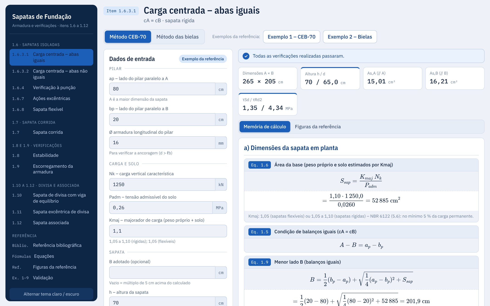
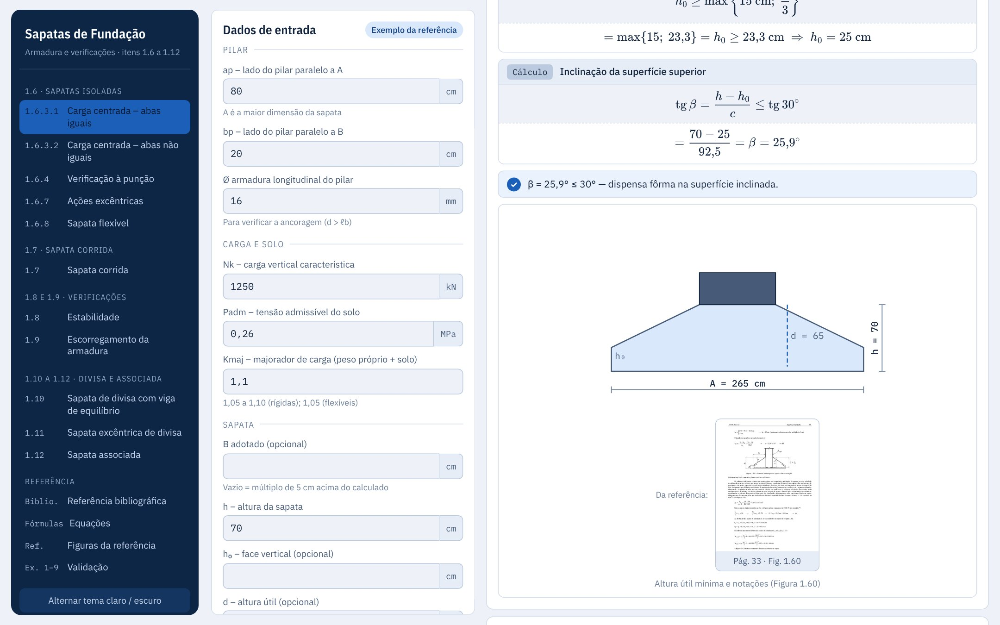
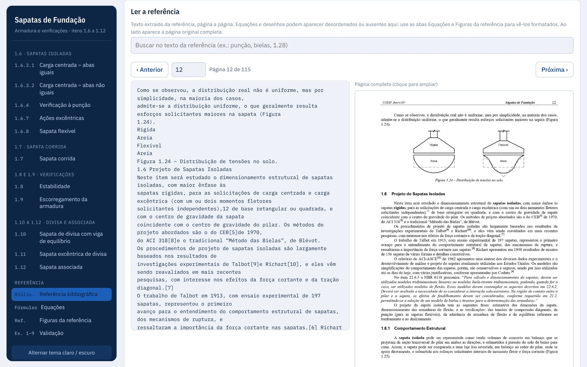
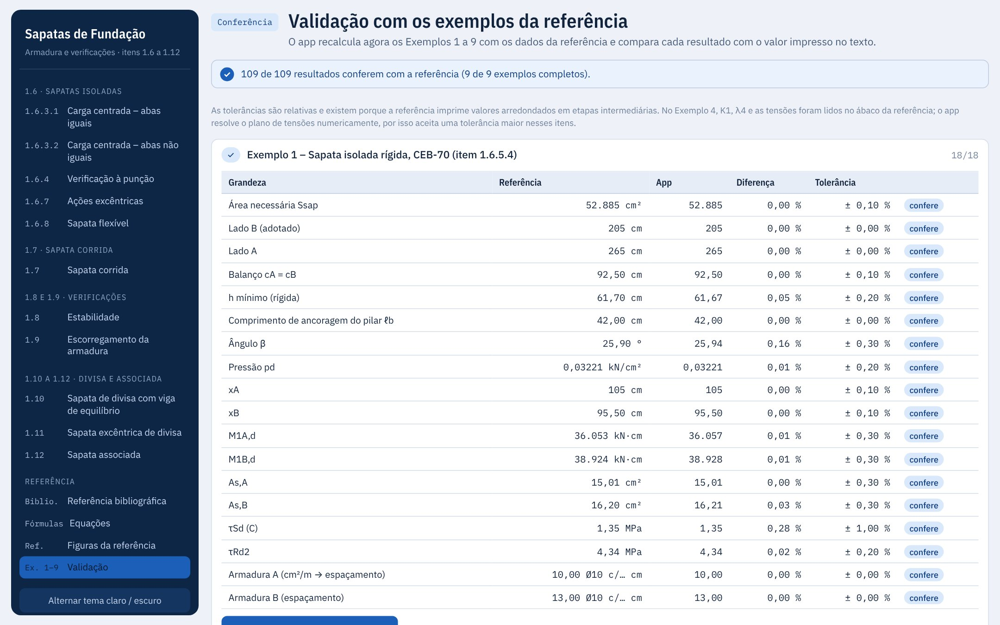
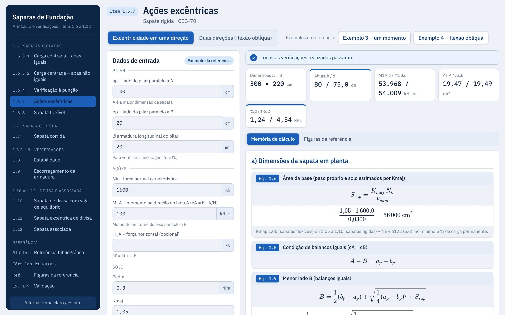

# Sapatas de fundação

Calculadora e referência de **sapatas de fundação** (isoladas, corrida, de divisa e associada), em um único arquivo `index.html`, baseada nas notas de aula *Sapatas de Fundação* do Prof. Dr. Paulo Sérgio dos Santos Bastos (UNESP – Bauru/SP).

Cada calculadora gera uma memória de cálculo passo a passo, com as equações do texto, esboço, exemplos da referência e verificações.



## Como usar

Abra o `index.html` no navegador. Não precisa instalar nada nem subir servidor.

As equações usam KaTeX e as fontes vêm do Google Fonts, carregados da internet: sem conexão o cálculo funciona, mas as fórmulas aparecem como texto TeX.

Para publicar como site, ative o GitHub Pages em *Settings → Pages* (branch `main`, pasta `/ (root)`). Os caminhos de `figs/` são relativos e funcionam sem ajuste.

## O que o app tem

| Item do texto | Página do app |
|---|---|
| 1.6.3.1 | Carga centrada, abas iguais |
| 1.6.3.2 | Carga centrada, abas não iguais |
| 1.6.4 | Verificação à punção |
| 1.6.7 | Ações excêntricas |
| 1.6.8 | Sapata flexível |
| 1.7 | Sapata corrida |
| 1.8 | Estabilidade |
| 1.9 | Escorregamento da armadura |
| 1.10 | Sapata de divisa com viga de equilíbrio |
| 1.11 | Sapata excêntrica de divisa |
| 1.12 | Sapata associada |

Além das calculadoras:

- **Referência bibliográfica:** como citar, sumário com atalho "Calcular", busca no texto e leitor página a página, com o texto e a imagem da página completa (clique para ampliar).
- **Equações:** todas as fórmulas usadas, com a numeração do texto (Eq. 1.x).
- **Figuras da referência:** as páginas com desenhos, agrupadas por assunto.
- **Validação:** o app recalcula os Exemplos 1 a 9 do texto e compara com os valores impressos (109 resultados). As tolerâncias existem porque a referência arredonda etapas intermediárias; no Exemplo 4, K1, λ4 e as tensões foram lidos em ábaco.

As tabelas do Anexo A do texto estão embutidas no app.

## Telas do app

**Memória de cálculo com as equações do texto e o esboço da sapata.**



**Referência bibliográfica: texto extraído ao lado da página completa do PDF.**



**Validação: o app recalcula os Exemplos 1 a 9 e confere cada resultado (109 de 109).**



**Ações excêntricas (item 1.6.7).**



## Estrutura do repositório

```
index.html        app completo: HTML, CSS, JavaScript e dados
figs/pNNN.jpg     páginas da referência; NNN = página do PDF (página do texto = NNN − 4)
tests/smoke.py    teste de fumaça (menu, validação e imagens do leitor)
tools/prints.py   gera os prints de docs/prints/ usados neste README
docs/prints/      prints do app (JPG)
CHANGELOG.md      histórico das mudanças
CLAUDE.md         notas de trabalho para quem for mexer no código
```

`figs/` tem as 119 páginas do PDF: 001 a 004 são capa e sumário (página 0 do leitor) e 005 a 119 são as páginas 1 a 115 do texto.

## Repositórios relacionados

Mesmo texto-base e mesma estrutura de app:

- [victortlacerda/blocos-coroamento](https://github.com/victortlacerda/blocos-coroamento): blocos sobre estacas, CEB-70, momentos e bloco de transição.
- [victortlacerda/tubulao](https://github.com/victortlacerda/tubulao): tubulão a céu aberto (fuste e base alargada).

## Como atualizar

1. Edite o `index.html` (ele é o app inteiro: ver `CLAUDE.md` para a organização interna).
2. Rode `python3 tests/smoke.py` (precisa de `pip install playwright` e `playwright install chromium`). A página Validação tem de continuar toda conferida.
3. Se a tela mudou, refaça os prints: `python3 tools/prints.py` (as instruções de instalação estão no topo do script).
4. Anote a mudança no `CHANGELOG.md`.
5. Faça o commit e envie: `git add -A && git commit -m "..." && git push`.

## Fonte e créditos

Texto-base:

> BASTOS, P. S. S. *Sapatas de Fundação*. Notas de aula da disciplina 2133 – Estruturas de Concreto III. Bauru/SP: Departamento de Engenharia Civil e Ambiental, Universidade Estadual Paulista (UNESP), out. 2023.

Página do autor: <https://wwwp.feb.unesp.br/pbastos>. O texto segue a NBR 6118/2023 e a NBR 6122/2021.

Os direitos do texto e das figuras pertencem ao autor e à UNESP. As imagens de `figs/` são páginas dessas notas de aula, reproduzidas para consulta junto às fórmulas.

O app é uma ferramenta de apoio ao estudo e ao pré-dimensionamento: o projeto final deve ser conferido por engenheiro responsável.
